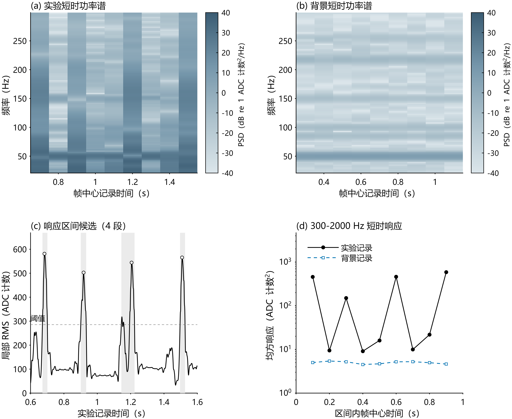

# 实验振动信号分析

[](https://github.com/Supercraft-1/Liquor_Sloshing_Signal_Analysis/actions/workflows/reproduce.yml)

对一组实验记录和背景记录进行离线分析，包括波形、FFT 幅值谱、Welch 功率谱、频段积分及短时响应。仓库附有原始记录、示例 CSV、固定参数和参考结果。

## 运行

需要 MATLAB R2025b 和 Signal Processing Toolbox。下载并解压仓库，在 MATLAB 中打开仓库根目录，运行：

```matlab
run_demo
```

程序读取 `data/` 下的两份 CSV，结果保存到 `output/`。重复运行会覆盖同名输出，输入数据保持原样。也可以指定保存目录：

```matlab
result = run_demo('D:/my-results');
```

中文图使用 Noto Sans SC／Noto Sans CJK SC，或受支持的系统中文字体。Windows 可使用微软雅黑，Ubuntu 安装 `fonts-noto-cjk`。PNG 为 600 dpi；波形、FFT 和功率谱 PDF 保留矢量曲线和文字，短时分析 PDF 使用 600 dpi 图像导出。

## 数据和参数

示例取自 `Signal_0512_2320.xlsx` 和 `Background_0512_2319.xlsx`。CSV 保留完整的时间列与 ADC 计数，来源及文件哈希见 [数据说明](data/README.md)。

| 参数 | 设置 |
| --- | --- |
| 采样率 | 5000 Hz |
| 实验窗口 | [0.60, 1.60) s，5000 点 |
| 背景窗口 | [0.20, 1.20) s，5000 点 |
| 预处理 | 完整记录去均值、SOS 零相位带通；截窗后再次去均值 |
| 带通 | 20–2000 Hz，4 阶 Butterworth 原型，单次带通为 8 阶 |
| FFT | 1 s 周期 Hann 窗，8192 点，按窗相干增益修正幅值 |
| Welch | 1000 点周期 Hann 窗，500 点重叠，2048 点 FFT，9 帧平均 |
| 统计频段 | 20–50、50–300、300–1000、1000–2000 Hz |
| 局部 RMS | 20 ms 窗；合并间隙不超过 40 ms，实际活动时长至少 6 ms |

参数在 [src/case_config.m](src/case_config.m)。完整计算过程见 [方法说明](docs/methodology.md)，局部活动阈值和谱峰匹配规则见 [短时分析](docs/time_diagnostics.md)。

## 示例结果

### 波形


灰线为完整实验记录，黑线标出分析窗口。实验与背景的窗口波形采用独立纵轴，AC RMS 分别为 196.9121 和 8.2696 ADC counts。

[波形 PDF](expected/waveform.pdf)

### FFT 幅值谱


实验为黑色实线，背景为蓝色虚线。实验最大幅值位于 50.0488 Hz，对应 95.0972 ADC counts。下图空心圆标出与背景强峰相距不超过 2 Hz 的实验峰。

[频谱 PDF](expected/spectrum.pdf)

### Welch 功率谱与频段积分


下图各点为 PSD 的频段积分，百分比为该频段占实验总功率的比例。

| 频段 | 实验功率（ADC counts²） | 背景功率（ADC counts²） | 实验占比 |
| --- | ---: | ---: | ---: |
| 20–50 Hz | 28490.3472 | 29.9980 | 65.55% |
| 50–300 Hz | 14782.5619 | 33.6277 | 34.01% |
| 300–1000 Hz | 173.9121 | 2.8294 | 0.40% |
| 1000–2000 Hz | 17.0605 | 2.1581 | 0.04% |

实验 20–2000 Hz 的积分为 43463.8817 ADC counts²。Welch 使用分帧加窗平均，其时间权重与整窗 RMS 不同。

[功率谱 PDF](expected/power.pdf) · [汇总指标](expected/metrics.csv) · [频段指标](expected/band_metrics.csv)

### 短时功率谱与响应区间



上方为平均前的 9 帧 PSD，放大到 20–300 Hz，使用共同的蓝灰色标。左下灰色区域是局部 RMS 超阈值区间，右下为每帧 300–2000 Hz 的积分。

实验检出 4 段活动，背景为 0 段。第 3 段包含间隔较近、合并后的活动区间。

| 区间（s，右端不包含） | 局部 RMS 最大值时刻（s） |
| --- | ---: |
| [0.6714, 0.7010) | 0.6834 |
| [0.9012, 0.9336) | 0.9178 |
| [1.1444, 1.2236) | 1.2060 |
| [1.4964, 1.5264) | 1.5088 |

两条 FFT 有 4 对邻近强峰，约在 50、84–85、100 和 150 Hz。其中 83.62 与 85.45 Hz 相差约 1.83 Hz，只是落在匹配容差内。

[短时分析 PDF](expected/diagnostics.pdf) · [活动区间](expected/response_candidates.csv) · [邻近峰](expected/common_peaks.csv) · [逐帧频段积分](expected/time_band_metrics.csv)

### 结果的解释

实验和背景是独立记录，图中的时间不代表同步采样。ADC 尚未标定为电压或加速度，频段积分的单位是计数平方。

约 50 Hz 的峰在两条记录中都存在，来源需要实验验证。局部 RMS 区间用于定位较强活动，不能单凭它确定施力或自由衰减的起止；邻近峰匹配也不等同于同一物理模态。当前分析保留两条独立频谱，不作谱减、50 Hz 陷波或模态参数拟合。

相关方法及后续实验条件见 [12 篇文献的阅读记录](docs/literature_review.md)。

## 输出和代码

| 输出 | 内容 |
| --- | --- |
| `waveform`、`spectrum`、`power`、`diagnostics` 的 PNG／PDF | 四组结果图 |
| `metrics.csv`、`band_metrics.csv` | 汇总指标、频段功率及占比 |
| `spectrum.csv`、`psd.csv` | 完整 FFT 幅值谱和 Welch PSD |
| `time_frequency.csv`、`time_band_metrics.csv` | 逐帧 PSD 和频段积分 |
| `local_rms.csv`、`response_candidates.csv` | 局部 RMS 和活动候选区间 |
| `common_peaks.csv` | 邻近峰的频率、距离和幅值 |
| `analysis.mat` | 完整 `result` 结构体 |
| `run_metadata.json` | MATLAB 版本、参数、单位和计算规则 |

```text
run_demo.m                 运行入口
src/case_config.m          参数
src/load_recording.m       读取 CSV
src/analyze_pair.m         数据检查、预处理、FFT、Welch 及汇总指标
src/analyze_diagnostics.m  逐帧谱、活动区间和峰匹配
src/integrate_psd.m        精确频段边界积分
src/plot_case.m            绘图
src/export_results.m       保存表格、MAT 和元数据
data/                      示例 CSV
expected/                  参考图和数值
tests/                     数值与复现测试
legacy/                    历史程序和 Excel 记录
```

## 测试

在仓库根目录运行：

```matlab
results = runtests('tests');
assertSuccess(results);
```

测试覆盖正弦幅值与均方功率、PSD 归一化、频段积分、活动合并、边缘窗口、峰匹配、零响应和无效输入，并核对示例结果。参考数值按容差比较；不同系统的字体和图像像素可能略有差别。

[GitHub Actions](https://github.com/Supercraft-1/Liquor_Sloshing_Signal_Analysis/actions/workflows/reproduce.yml) 在 Ubuntu 中运行 R2025b 测试，生成的 19 个输出文件保留 7 天。

找不到入口时，检查当前目录是否包含 `run_demo.m`；缺少工具箱或中文字体时，程序会提示安装。旧交互程序留在 `legacy/`，不参与上述运行流程。

代码与公开数据采用 [MIT License](LICENSE)。
