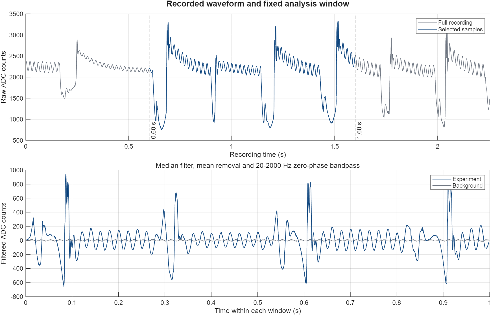
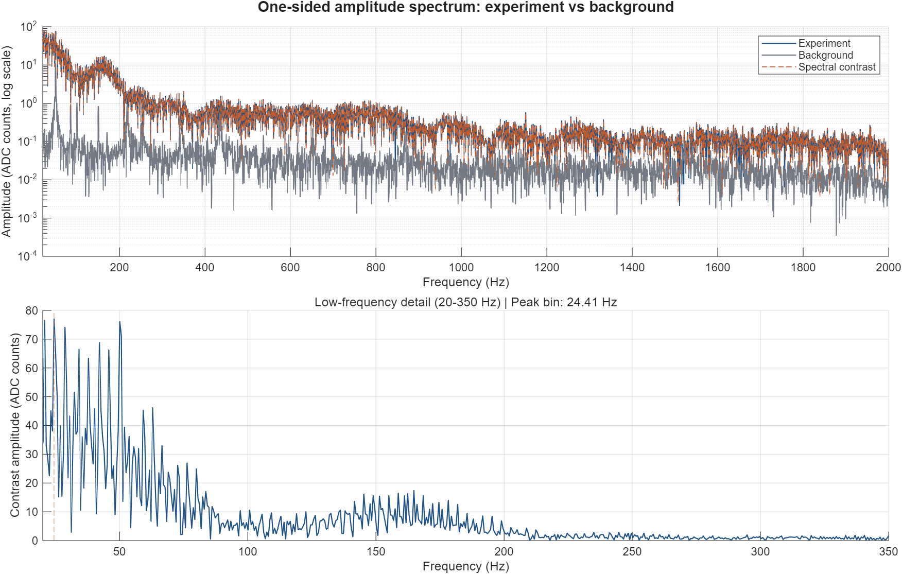
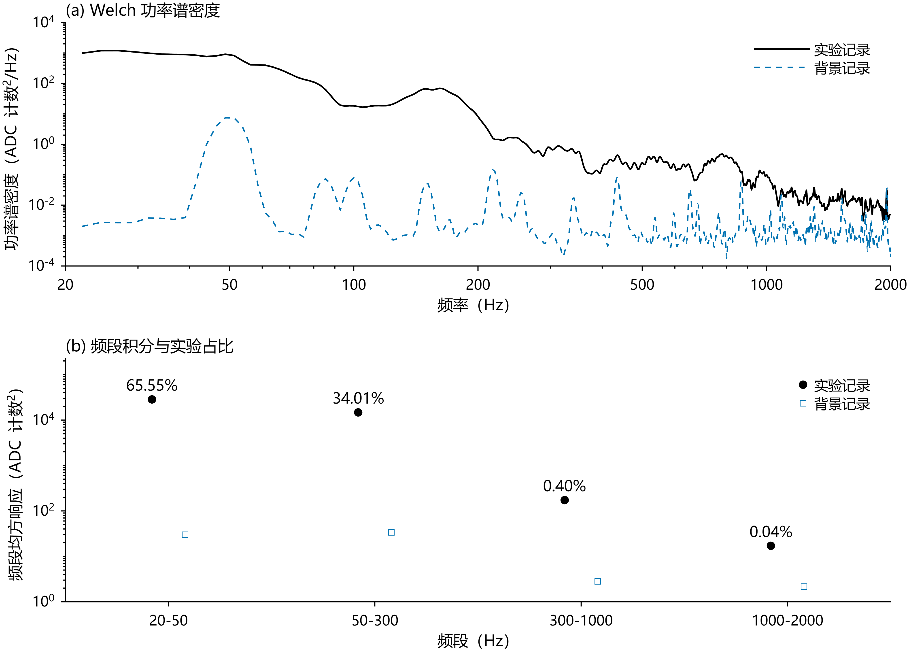
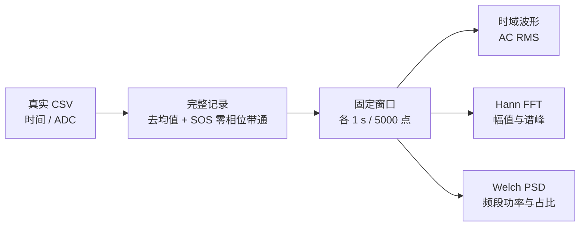

# 实验振动信号的离线频谱分析

[](https://github.com/Supercraft-1/Liquor_Sloshing_Signal_Analysis/actions/workflows/reproduce.yml)

使用一段实验记录和一段背景记录，完成时域预处理、FFT 幅值谱、Welch 功率谱与频段统计。输入数据、处理参数、参考数值和结果图均随仓库提供。

**唯一运行入口：`run_demo.m`。** 不需要采集设备，不弹出选文件或选区间窗口，也不需要在历史实验版本之间选择。

## 三步运行

环境：**MATLAB R2025b + Signal Processing Toolbox**。无需 Excel、串口、Python 或第三方 MATLAB 包。

1. 点击 **Code → Download ZIP**，解压整个仓库。
2. 在 MATLAB 中，把 **Current Folder** 切换到包含 `run_demo.m` 的仓库根目录。
3. 在命令窗口运行：

```matlab
run_demo
```

运行完成后，结果写入自动创建的 `output/`。再次运行会更新同名结果，原始数据不会被修改。

| 结果文件 | 内容 |
| --- | --- |
| `waveform.png / .pdf` | 原始记录、分析窗口、实验与背景的 AC 波形 |
| `spectrum.png / .pdf` | 独立 FFT 幅值谱及低频局部放大 |
| `power.png / .pdf` | Welch PSD、频段功率和实验功率占比 |
| `metrics.csv` | RMS、谱峰、质心与总频段功率 |
| `band_metrics.csv` | 每个频段的实验／背景功率、等效 RMS 和占比 |
| `spectrum.csv / psd.csv` | 完整频率网格与频谱数值，用于自行作图 |
| `analysis.mat` | 完整 `result` 结构体 |
| `run_metadata.json` | 环境版本、参数、归一化方式和单位 |

PNG 为 600 dpi，PDF 保留矢量图元。图表使用中文标签、白底细线和无网格坐标；需要安装 Noto Sans SC／Noto Sans CJK SC 或受支持的系统中文字体。排版取舍见 [图表规范](docs/figure_style.md)。

## 数据与固定参数

示例来自仓库原有的 `Signal_0512_2320.xlsx` 和 `Background_0512_2319.xlsx`。两份 CSV 完整保留时间戳和 ADC 计数，**没有合成、重采样或截断**；原始文件、样本数和哈希见 [数据来源](data/README.md)。

| 项目 | 固定设置 |
| --- | --- |
| 采样率 | 5000 Hz |
| 实验窗口 | `[0.60, 1.60)` s，5000 点 |
| 背景窗口 | `[0.20, 1.20)` s，5000 点 |
| 预处理 | 完整记录去均值 → SOS 零相位带通 → 截窗 → 去除窗口残余均值 |
| 带通 | 20–2000 Hz，4 阶 Butterworth 原型；单次带通为 8 阶，前后向滤波 |
| FFT | 1 s 周期 Hann 窗，8192 点，幅值按窗相干增益归一化 |
| Welch PSD | 1000 点周期 Hann 窗，500 点重叠，2048 点 FFT，9 段平均 |
| 统计频段 | 20–50、50–300、300–1000、1000–2000 Hz |

参数集中在 [src/case_config.m](src/case_config.m)，默认入口始终运行这一对数据、这一套参数。

## 应当看到的结果

参考文件位于 `expected/`，由同一入口实际生成，不是另行绘制的示意图。

### 时域：先看记录，再看窗口内响应



灰色为整段原始实验记录，黑色段与虚线边界标出固定分析窗口。下方将实验与背景分开展示，**两个子图的纵轴范围不同**，因此背景的小幅波动也能看清。两条波形来自独立记录，不表示同步采样。

实验 AC RMS 为 **196.9121 ADC counts**，背景为 **8.2696 ADC counts**。

[矢量 PDF](expected/waveform.pdf)

### 幅值谱：保留谱峰细节



上图用对数频率轴展示整个分析频段，下图放大 20–200 Hz。黑色实线和蓝色虚线分别为实验与背景的独立幅值谱，没有做谱减，也没有为了图形平滑而再滤波。

实验最大 FFT 频点为 **50.0488 Hz**，对应幅值 **95.0972 ADC counts**。背景在约 50 Hz 附近也有谱峰；仅凭这对记录，不能把该频率认定为样品特征或瓶体固有频率。

[矢量 PDF](expected/spectrum.pdf)

### 功率谱：比较各频段贡献



Welch PSD 用分段平均展示频谱的整体分布；下方点图是对 PSD 按频率积分后的均方响应，单位为 **ADC counts²**，纵轴采用对数刻度。黑色实心圆与蓝色空心方块分别表示实验与背景，不连线、不添加误差条。圆点上方的百分比是该频段占实验 20–2000 Hz 功率的比例，不是信噪比。

| 频段 | 实验功率（ADC counts²） | 背景功率（ADC counts²） | 实验占比 |
| --- | ---: | ---: | ---: |
| 20–50 Hz | 28490.3472 | 29.9980 | 65.55% |
| 50–300 Hz | 14782.5619 | 33.6277 | 34.01% |
| 300–1000 Hz | 173.9121 | 2.8294 | 0.40% |
| 1000–2000 Hz | 17.0605 | 2.1581 | 0.04% |

实验 20–2000 Hz 的 PSD 积分为 **43463.8817 ADC counts²**。这条记录含多次瞬态，Welch 加窗平均与整窗时域 RMS 的时间权重不同，两者不要求严格平方对应。

[矢量 PDF](expected/power.pdf) · [完整指标](expected/metrics.csv) · [频段指标](expected/band_metrics.csv)

## 方法与代码



FFT 回答“哪些频点的幅值较大”，PSD 积分回答“这个频段贡献了多少均方响应”。两者采用不同的窗归一化，不能直接混用。窗口长度、频率网格、滤波顺序及指标公式见 [处理方法](docs/methodology.md)。

记录中的 ADC 尚未标定为电压或加速度。本例展示信号处理过程，不输出液体分类、检测准确率或单次自由衰减参数。

进一步的算法取舍见 [12 篇相关文献与改进建议](docs/literature_review.md)，涵盖谱估计、短时分析、瞬态检测、模态识别及容器液体响应。改进建议与当前已实现的方法分开说明。

```text
run_demo.m               唯一入口，串联读取、分析和导出
src/case_config.m        固定案例参数
src/load_recording.m     CSV 列检查与读取
src/analyze_pair.m       数据检查、全记录滤波、FFT / Welch 和指标
src/integrate_psd.m      精确频段边界插值与积分
src/plot_case.m          统一图表样式，导出 PNG / PDF
src/export_results.m     表格、MAT 和方法元数据
data/                    两份完整 CSV 及来源
expected/                实际生成的参考图与数值
tests/                   分析方法与端到端复现测试
legacy/                  原始采集／分析版本和 Excel 记录，不参与默认运行
```

## 核对与常见问题

在仓库根目录运行：

```matlab
results = runtests('tests');
assertSuccess(results);
```

测试覆盖解析正弦信号的频率、幅值和均方功率，补零与功率积分、背景不消除实验谱峰、原始数据一致性、重复运行、输出文件，以及错误时间戳、NaN 和不完整窗口等情况。参考数值用容差比较，不要求跨平台 PNG 的像素完全一致。

[GitHub Actions](https://github.com/Supercraft-1/Liquor_Sloshing_Signal_Analysis/actions/workflows/reproduce.yml) 会在独立 Ubuntu 环境安装 R2025b 和工具箱，运行这些测试及 `run_demo`，将 12 个输出文件作为附件保留 7 天。

- **找不到 `run_demo`**：确认当前文件夹是仓库根目录，不是 `src/` 或 `legacy/`。
- **`Sloshing:MissingToolbox`**：安装并激活 Signal Processing Toolbox。
- **`Sloshing:MissingChineseFont`**：安装免费的 Noto Sans SC 字体后重启 MATLAB；Ubuntu 可安装 `fonts-noto-cjk`。自动复现环境已配置此步骤。
- **写入失败**：把仓库放到可写目录；也可用 `run_demo('D:/my-results')` 指定输出位置。它只改变保存位置，不改变实验。
- **结果与旧图不同**：处理顺序、窗函数和功率计算已统一；请与当前 `expected/` 比较，不再使用历史界面的数值作为参考。

代码与公开数据采用 [MIT License](LICENSE)。
